# NEXORA: Construction Procurement & Logistics Management System

**Enterprise web application for construction companies: purchase requests (RQI), tenders (OPL), projects, logistics tasks, vehicle reservations, budget reports, users, roles and audit trail. Built with Next.js 15, React 19, TypeScript and Tailwind CSS, with a fully mocked data layer so the entire system runs without any backend or database.**

> Resumen en español: sistema de gestión de obras para empresas constructoras. Pedidos de compra (RQI) en tablero Kanban, licitaciones (OPL), obras e imputaciones, logística, reservas de vehículos, reportes presupuestarios, usuarios, roles y auditoría. Esta versión es una demo con datos simulados en memoria.

---

## Demo

| Purchase requests (Kanban) | Request detail | Tenders (Kanban) |
|---|---|---|
| 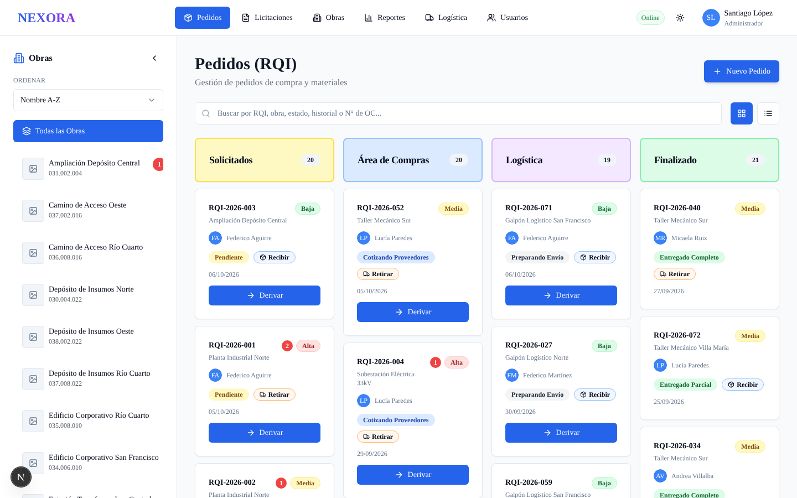 | 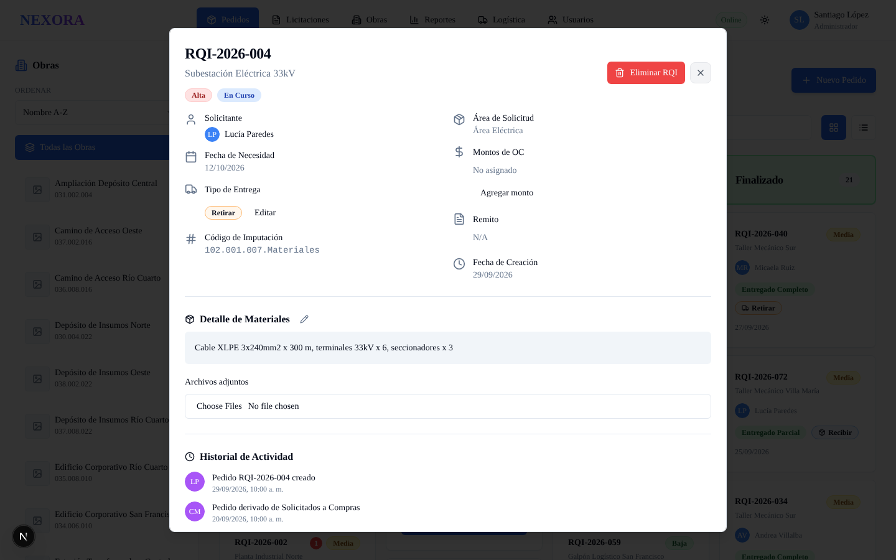 | 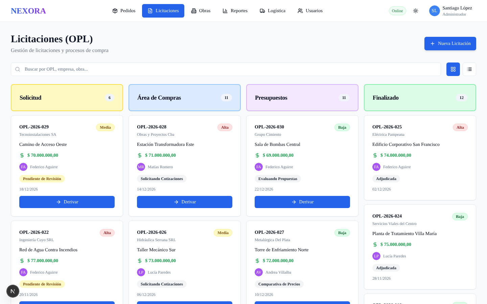 |

| Projects | Budget reports | Logistics tasks |
|---|---|---|
| 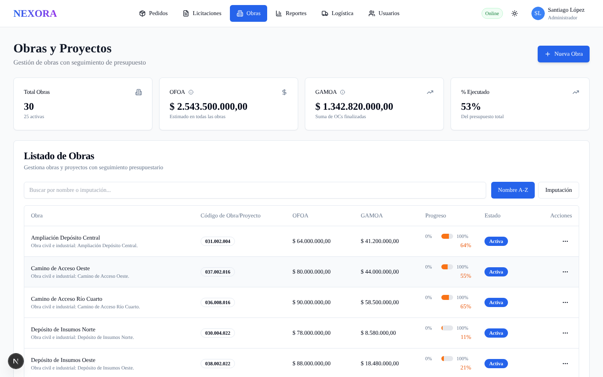 | 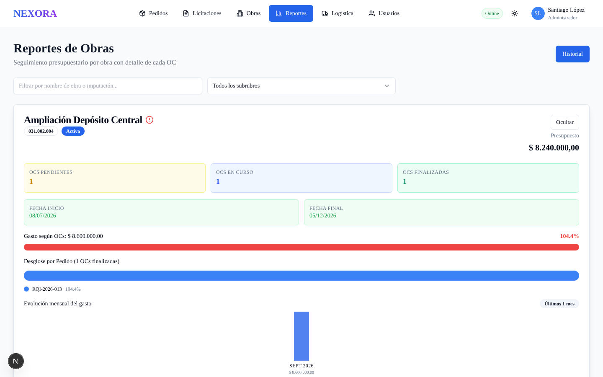 | 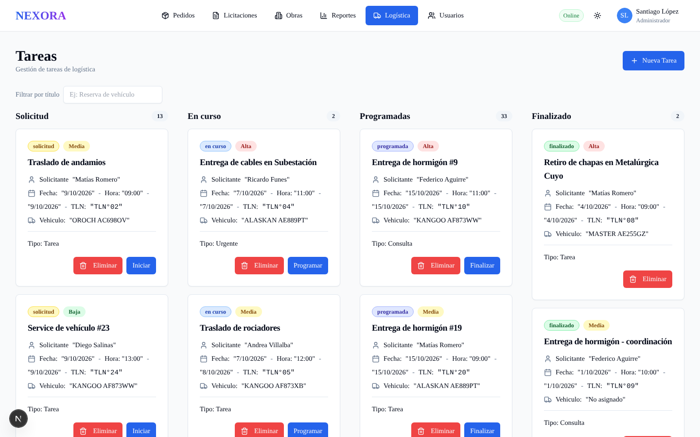 |

| Weekly calendar | Vehicle reservations | Users, roles and audit |
|---|---|---|
| 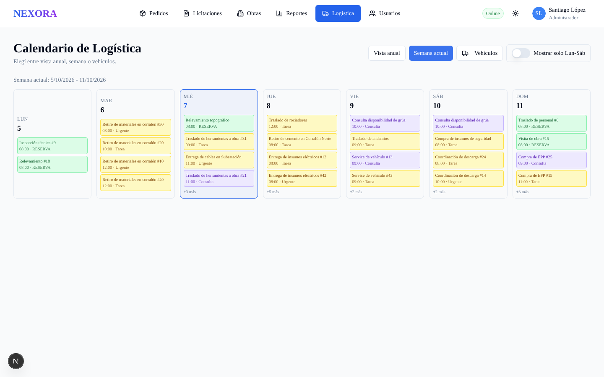 | 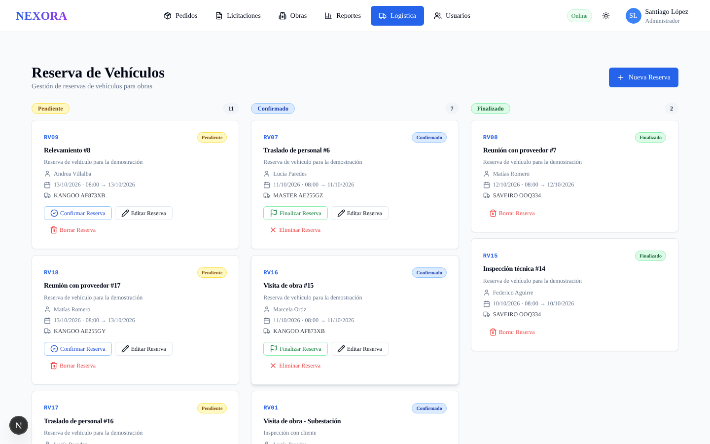 | 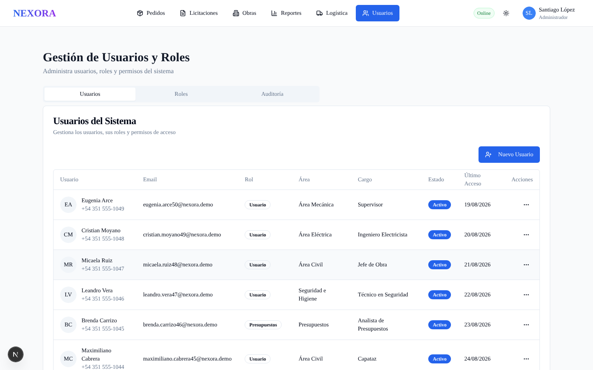 |

| Landing page | Login |
|---|---|
| 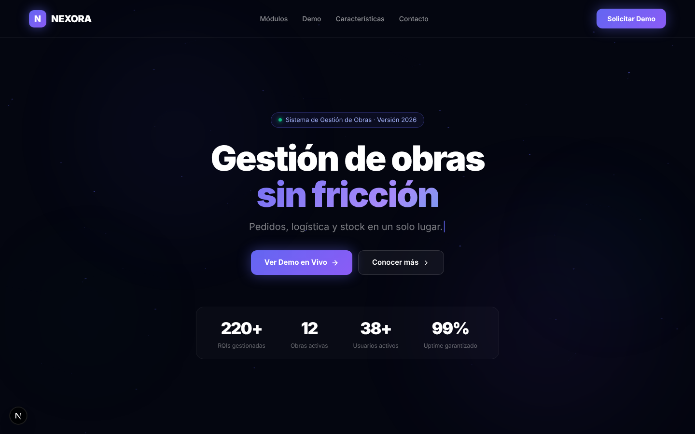 | 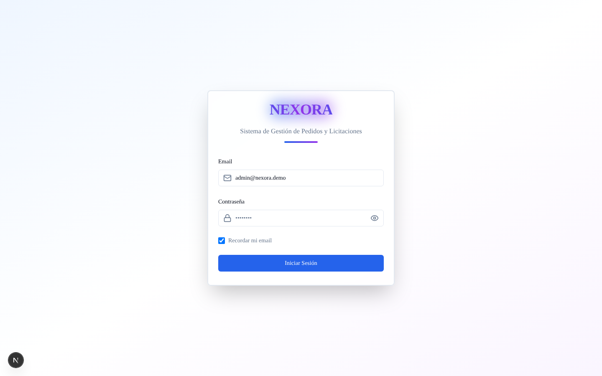 |

---

## Key Features

- **Purchase requests (RQI):** Kanban board with four workflow areas (Requested, Purchasing, Logistics, Finalized), table view, live search, automatic RQI numbering, status history, comments with `@mentions`, document attachments, partial deliveries and delivery receipts.
- **Tenders (OPL):** Kanban by process phase (Request, Purchasing, Budgeting, Finalized), amounts, priorities, history and attached bid documents.
- **Projects (Obras):** budget, spent amount, cost-center codes (imputaciones), responsible person, dates and status.
- **Budget reports:** spend vs. budget per project, order breakdown, monthly spend charts, alerts when a project exceeds its budget.
- **Logistics:** task board, annual / weekly calendar, vehicle fleet view and vehicle reservations with confirmation states.
- **Users and roles:** role-based access control (RBAC) with Administrator, Purchasing, Logistics, Budgeting and User roles, plus a full **audit log** of user actions.
- **Notifications:** in-app notifications per module, mentions and unread counters.
- **Modern UI:** shadcn/ui and Radix primitives, light / dark theme, responsive layout, animated cards, PWA support.

---

## Key Technical Highlights

### 1 · A drop-in mock data client

All components call the same `createClient()` they would use against a hosted backend. In this repository that client is an in-memory implementation of a query builder: `select` with embedded relations, `eq / in / ilike / or` filters, `order`, `limit`, `range`, `single`, `insert`, `update`, `delete`, `upsert`, auth, and a realtime channel emitter.

```typescript
// src/lib/mock/client.ts
import '@/lib/mock/install'
import { mockClient } from '@/lib/mock/mock-client'

export function createClient() {
  return mockClient as any
}
```

```typescript
// Same call shape used across the UI
const { data } = await dataClient
  .from('orders')
  .select(`*,
    solicitante:users!solicitante_id(id, name, email, area, avatar, role_id),
    responsable:users!responsable_id(id, name, email, area, avatar, role_id)`)
  .order('created_at', { ascending: false })
```

### 2 · Mocked REST routes through a `fetch` interceptor

File uploads, comments, delivery receipts and report endpoints that the UI calls under `/api/*` are answered by an in-memory handler installed as a side effect. Uploaded files become `blob:` URLs, so attachments can be added and previewed during the demo.

```typescript
window.fetch = async (input, init) => {
  if (!isMockRoute(input)) return realFetch(input, init)
  await sleep(120 + Math.random() * 180)           // simulated latency
  const res = await handleApi(method, url, init?.body)
  return new Response(JSON.stringify(res.body), { status: res.status })
}
```

### 3 · Role-aware business rules

Permissions are computed in a single hook (`use-permissions`): who can create, edit, derive, finalize or delete an order depends on role and ownership. Realtime-style updates are emulated, so moving a card on the Kanban board updates counters, history and notifications immediately.

### 4 · Rich, date-relative seed data

Demo content is generated relative to *today*: 50 users, 30 projects, 80 purchase requests, 40 tenders, 50 logistics tasks, 20 vehicle reservations, notifications and 100+ audit entries, so the system always looks like it is in daily use.

---

## Architecture

```
Next.js 15 (App Router) + React 19 + TypeScript
  |
  |-- app/ (landing, auth/login, dashboard/pedidos | licitaciones | obras | logistica | reportes | usuarios)
  |-- components/ (pedidos, licitaciones, obras, logistica, reportes, usuarios, shared, ui)
  |-- hooks/ (use-auth, use-permissions)
  |
  |-- lib/mock/client.ts ------ createClient() used by every component
  |        |
  |        |-- mock-client.ts   query builder, relations, auth, realtime emitter
  |        |-- mock-api.ts        /api/* handlers (uploads, comments, reports)
  |        |-- install.ts         fetch interceptor
  |        |-- store.ts / seed.ts in-memory tables and demo data
```

---

## Tech Stack

| Layer | Technology |
|---|---|
| Framework | Next.js 15 (App Router), React 19, TypeScript |
| Styling | Tailwind CSS, tailwindcss-animate, CSS keyframe animations |
| UI components | shadcn/ui, Radix UI, Lucide icons, Sonner toasts |
| Forms and validation | React Hook Form, Zod |
| Theming | next-themes (light / dark) |
| PWA | next-pwa |
| Dates | date-fns |
| Data layer (demo) | In-memory query builder, fetch interceptor, seeded relational data |

---

## Getting Started

```bash
git clone https://github.com/<your-user>/<your-repo>.git
cd <your-repo>
npm install
npm run dev
```

Open `http://localhost:3000`.

| Field | Value |
|---|---|
| Email | `admin@nexora.demo` (pre-filled) |
| Password | any value |

Other demo users: `compras@nexora.demo`, `logistica@nexora.demo`, `presupuestos@nexora.demo`, `faguirre@nexora.demo` (any password).

No environment variables, database or backend are required.

---

## What this solves

Construction companies run purchasing, tendering and logistics across spreadsheets and chat threads. NEXORA centralizes the full lifecycle of a purchase request from the field request to the delivery receipt, ties every order to a project and cost center, tracks budgets in real time and keeps an audit trail of every action.

> Portfolio / demo version: all data is fictional and generated in memory. Reloading the page restores the initial state.

---

## Keywords

Next.js, React, TypeScript, Tailwind CSS, shadcn/ui, Radix UI, App Router, Kanban board, procurement software, purchase order management, tender management, construction management software, logistics management, fleet and vehicle reservation, budget tracking, role-based access control (RBAC), audit log, notifications, dashboard, enterprise web application, Progressive Web App (PWA), React Hook Form, Zod, mock API, front-end architecture.

**Suggested GitHub topics:** `nextjs` `react` `typescript` `tailwindcss` `shadcn-ui` `kanban` `procurement` `construction` `logistics` `erp` `dashboard` `rbac` `audit-log` `pwa` `mock-api` `portfolio`
